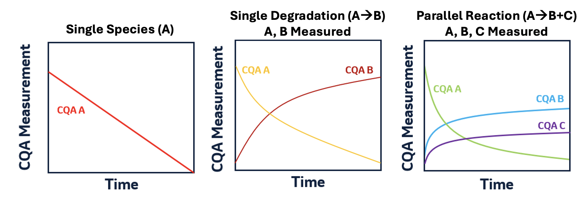

```{r, include = FALSE}
knitr::opts_chunk$set(
  collapse = TRUE,
  comment = "#>"
)
```

```{r setup, message=FALSE, warning=FALSE}
library(stablr)
library(tidyverse)
theme_set(theme_bw())

# Shared palette for storage temperatures, used throughout.
temp_cols <- c("navy", "dodgerblue", "lightgreen", "darkgoldenrod2", "red3")
```


## Kinetic Modeling Framework

This vignette provides an overview of the kinetic framework implemented in `stablr`. We model the critical quality attribute (CQA) $Y(t,T)$, which can increase or decrease over time and is often bounded (e.g., percentages), using an underlying latent process $\alpha(t)$:
$$ \text{CQA Equation} \quad \quad Y(t, T) = (Y_\infty - Y_0)\,\alpha(t) + Y_0 \tag{1}$$
where $\alpha(t)$ is fraction reacted ($\alpha(0) = 0$, $\alpha(\infty)=1$), $Y_0$ is initial assay value (t = 0) and $Y_\infty$ is the asymptotic value as the reaction completes.

We model $\alpha(t)$ using the following kinetic differential equation and the Šesták–Berggren (SB) model [@vsestak1971study, @perez2006combined]:

\begin{align}
&\text{Kinetic DE} \ && \frac{d\alpha}{dt} = k(T)\,f(\alpha) \tag{2} \\
&\text{Šesták–Berggren (SB) Model} \ && f(\alpha) = (1-\alpha)^{n}\,\alpha^{m} \tag{3} \\
\end{align}

where $\frac{d\alpha}{dt}$ is the rate of the reaction, $k(T)$ is temperature dependent rate constant, $f(\alpha)$ is kinetic model that describes the underlying reaction mechanism, $n$ is the order of the reaction and $m$ the autocatalytic parameter.

Finally, we model the rate constant $k(T)$ using the Arrhenius temperature dependence: 

$$ \text{Arrhenius Equation} \quad \quad k(T) = A\,e^{-\frac{E_a}{R\,T}} \tag{4}$$
where $A$ is the frequency factor (pre-exponential factor), $E_a$ the Activation Energy and $R$ is the universal gas constant, which is equal to 8.314 in $\mathrm{J,mol^{-1},K^{-1}}$ or 1.987 in $\mathrm{cal,mol^{-1},K^{-1}}$.

For stable estimation, we reparameterize with a *reference temperature* $T_\text{ref}$ (e.g., 298.15 K): $$ k(T) = k(T_\text{ref}) \exp\Bigl(\frac{E_a}{R}\Bigl(\frac{1}{T_\text{ref}}-\frac{1}{T}\Bigr)\Bigr) $$ 

This reparameterization offers several benefits:

- $k(T_\text{ref})$ is directly interpretable as the rate at the reference temperature.
- It reduces covariance dependence between ($A$) and ($E_a$). 
- The `stablr` package implements this through the `trefk` input. 

When stability studies span multiple relative humidity conditions, the rate law can be extended with a humidity-modified Arrhenius term; see `vignette("humidity-modified-arrhenius", package = "stablr")`.

The figure below illustrates the different degradation models available within the `stablr` package.




## Single Species Models ($\text{A} \xrightarrow\; \text{B}$)

These models capture a single, irreversible pathway with no parallel routes and no feedback from products, consistent with the Šesták–Berggren (SB) framework in (2)-(3) and Arrhenius \(k(T)\) in (4). The table below lists special-case when $n$ is an integer and $m=0$, which allows to solve the Kinetic DE (2) in closed-form:

<figure style="text-align:center;">
<table style="width:100%;">
  <tr>
    <th style="width:25%;">Model</th>
    <th style="width:10%;">Kinetic parameters</th>
    <th style="width:30%;">CQA Increasing</th>
    <th style="width:30%;">CQA Decreasing</th>
  </tr>
  <tr>
    <td><b>Zero-order</b></td>
    <td>n=0, m=0</td>
    <td>$Y_0 + k(T)t$</td>
    <td>$Y_0 - k(T)t$</td>
  </tr>
  <tr>
    <td><b>First-order</b></td>
    <td>n=1, m=0</td>
    <td>$Y_\infty - (Y_\infty - Y_0)\exp[-k(T)t]$</td>
    <td>$Y_0\exp[-k(T)t]$</td>
  </tr>
  <tr>
    <td style="white-space:nowrap;"><b>Higher-order</b></td>
    <td>n&ge;2, m=0</td>
    <td>$Y_\infty - \{(Y_\infty - Y_0)^{1-n} - (1-n)k(T)t\}^{1/(1-n)}$</td>
    <td>$\{Y_0^{1-n} - (1-n)k(T)t\}^{1/(1-n)}$</td>
  </tr>
</table>
<figcaption style="font-size:0.9em; text-align:left; margin-top:6px;">
Notes: <br>
(i) Kinetic parameter $n$ is assumed to be an integer.<br>
(ii) For increasing CQAs, set an appropriate assay bound $Y_\infty$ via <code>Yinf</code>.
</figure>


### Estimation with `fit_kinetic()`

`fit_kinetic()` leverages `build_kinetic()` with the optimization procedure in `gslnls::gsl_nls()` to estimate the model, and returns the fitted model. In the following example, we vary the **intercept** by batch and the **rate** by package, a common design in stability. The data used below come from the packaged datasets, but you can also generate stability data from any of these mechanisms with `simulate_kinetic_data()`, as shown in `vignette("simulating-stability-data", package = "stablr")`.

When the governing rate law is unknown, `fit_kinetic()` makes it straightforward to fit several kinetic orders to the same attribute and compare them; see `vignette("kinetic-model-comparison", package = "stablr")` for this workflow.


```{r example_kinetic_fit}
# `df` (Purity-only evers_supp) is defined here and reused by the fit_sb and
# prediction chunks further below.
df <- stablr::evers_supp |>
  dplyr::filter(cqa == "Purity", !is.na(y)) |>
  dplyr::mutate(
    batch = as.numeric(as.factor(batch)),
    pkg = as.numeric(as.factor(pkg))
  )
  
fit <- df |>
  stablr::fit_kinetic(
    kinetic_order = 0,
    trend = "decreasing",
    intercept_cols = "batch",
    rate_cols = "pkg"
  )

summary(fit)
```


## Single Degradation Models ($\text{A} \xrightarrow\; \text{B}$) with $A$, $B$ measured

When both the reactant ($A$) and product ($B$) are observed for a single, irreversible pathway $A \to B$, we can fit them **jointly** using a coupled model with shared kinetics and a simple mass-balance equation. We keep the Arrhenius temperature dependence (4) and Šesták–Berggren family for the underlying kinetics (2)-(3), but now predict two responses:

$$
\begin{align}
&\text{CQA Equation (A)} && Y_A(t,T) = (Y_{\infty} - A_0) \alpha(t) + A_0 \tag{5} \\
&\text{Mass Balance (B)} && Y_B(t,T) = B_0 + \bigl(A_0 - Y_A(t,T)\bigr) \tag{6}
\end{align}
$$

where:

- $A_0$ and $B_0$ are intercepts (initial values at $t=0$), which can vary by grouping factors specified via `intercept_cols`.
- The rate $k(T)$ can vary by grouping factors via `rate_cols`.
- Direction of the $A$ trajectory is chosen with `trend` (`"decreasing"` for $A$ when it degrades into $B$; `"increasing"` otherwise).
- Reaction *order* is set by `kinetic_order` ($0,1,2,\dots$). 

### Data preparation

To fit the model, we provide $A$ and $B$ in *wide* format (columns `yA`, `yB`), along with temperature in Kelvin and time. Here we create a demo data frame from `nrcesds`:

```{r ab_data, message=FALSE, warning=FALSE}
df_ab <- nrcesds |>
  tidyr::pivot_wider(names_from = "cqa", values_from = "y")
```


### Estimation with `fit_singledeg()`

We use `fit_singledeg()` to estimate both responses jointly. Here we fit a *second-order* model (`kinetic_order = 2`) with $A$ *decreasing*.  

```{r ab_fit, message=FALSE, warning=FALSE}
fit_ab <- df_ab |> 
  fit_singledeg(
    kinetic_order = 2,
    # rate_cols   = c("batch"),  
    trend = "decreasing",
    yA_var = "NR Major Peak",
    yB_var = "NR Minor Peaks"
  )

coef(fit_ab)
```


## Single Species Šesták–Berggren Model ($\text{A} \xrightarrow\; \text{B}$) 

The Šesták–Berggren (SB) model provides a flexible, mechanistic description for single-pathway degradation when only one CQA is measured (e.g., purity loss, potency decline, aggregate formation). Unlike the closed–form models in the previous sections, the SB model allows non-integer kinetic orders, autocatalysis, and richer curve shapes. The full model comprises (1) the CQA equation, (2) the kinetic DE, (3) the SB kinetic model, and (4) the Arrhenius rate law, where now the kinetic order $n$ and autocatalytic parameter $m$ are estimated from data.

As with the other models, the SB DE model allows flexible grouping structures via `intercept_cols` and `rate_cols`. The DE for $\alpha(t)$ is solved using `deSolve::ode()` for each unique combination of rate group, intercept group and temperature. The optimization problem is nonlinear and is optimized with Levenberg–Marquardt via `minpack.lm::nls.lm()`, with user-definable parameter bounds.

### Estimation with `fit_sb()`

`fit_sb()` leverages `build_alpha_ode()` together with the Levenberg–Marquardt optimizer in `minpack.lm::nls.lm()` to estimate the model, and returns the fitted model. In the following example, we vary **rate** by package, a common design in stability.

```{r example_sb}
out_sb <- df |>
  fit_sb(
    rate_cols      = "pkg",    # rate varies by package
    # intercept_cols = "batch",  # intercept varies by batch
    outcome_var    = "y",
    time_var       = "time",
    temp_var       = "tempk",
    trend          = "decreasing",
    Yinf           = 0
  )

summary(out_sb)
```


The fitted model can generate predictions on: training data (default), new datasets with identical grouping structure, new grouping levels (with `rate_override` or `intercept_override`), or latent $\alpha(t)$ values using `return_alpha = TRUE`. To assess the impact of temperature excursions outside the intended storage condition, the same fitted models can be passed to `predict_tos()`, covered in `vignette("predict-tos", package = "stablr")`.

```{r predict_sb, fig.width=7,fig.height= 5.5}
## 1. Create a grid of points ----
time_grid <- seq(0, max(df$time), length.out = 100)

newdata_sb <- df |>
  dplyr::reframe(
    time = time_grid,
    .by = c(tempk, batch, pkg)
  )

## 2. Predict Y(t, T) and alpha(t, T) on the grid ----
## Solve the ODE once per response by referencing the grid data frame by name.
newdata_sb <- newdata_sb |>
  dplyr::mutate(
    y_pred     = predict(out_sb, newdata = newdata_sb),
    alpha_pred = predict(out_sb, newdata = newdata_sb, return_alpha = TRUE)
  )

## 3. Plot: observed points + prediction lines ----
ggplot() +
  # observed data
  geom_point(
    data = df,
    aes(x = time, y = y, colour = factor(tempk))
  ) +
  # model-implied trajectories
  geom_line(
    data = newdata_sb,
    aes(
      x = time, y = y_pred,
      colour = factor(tempk),
      group  = interaction(tempk, batch, pkg)
    )
  ) +
  facet_wrap(~batch) +
  labs(
    x = "Time", y = "CQA",
    colour = "Temperature (K)"
  ) +
  ggplot2::scale_color_manual(
    name = "Temperature (K)",
    values = temp_cols
  )


```

## Parallel Reaction Models ($\text{A} \xrightarrow\; \text{B,C}$)

Parallel pathways are common when a parent species *A* converts into two measurable products *B* and *C* (e.g., HMWS and LMWS). We retain Arrhenius temperature dependence and Šesták–Berggren–type kinetics but split the apparent rate across branches (*B* and *C*). Let $k_B(T)$ and $k_C(T)$ be branch-specific Arrhenius rate constants and $k_A(T)$ the total rate for *A*. With baseline (intercept) levels $A_0,B_0,C_0$ and time $t$,

\begin{align}
&  && k_B(T)=k_{B,\mathrm{ref}}\exp\Bigl(\frac{E_{a,B}}{R}\Bigl(\frac{1}{T_\text{ref}}-\frac{1}{T}\Bigr)\Bigr)\\
&\text{Parallel Arrhenius Rates} &&  k_C(T)=k_{C,\mathrm{ref}}\exp\Bigl(\frac{E_{a,C}}{R}\Bigl(\frac{1}{T_\text{ref}}-\frac{1}{T}\Bigr)\Bigr) \tag{7} \\
&  && k_A(T)=k_B(T)+k_C(T) 
\end{align}

The *A*-trajectory follows the single-degradation closed form (consistent with (2)–(3)) using $k_{A}(T)$. While the mass balances from the loss of 
*A* is allocated proportionally to *B* and *C*:

\begin{align}
Y_B(t,T)=B_0+\frac{k_B(T)}{k_{A}(T)}\bigl(A_0-Y_A(t,T)\bigr),\qquad Y_C(t,T)=C_0+\frac{k_C(T)}{k_{A}(T)}\bigl(A_0-Y_A(t,T)\bigr). \tag{8}
\end{align}


### Estimation with `fit_parallel()`

`fit_parallel()` wraps the parallel kinetics into a vector-valued residual for `gslnls::gsl_nls()`. You pass the *three responses* (*A,B,C*) (wide format), temperature (Kelvin), time, and optional grouping factors for *intercepts* and *rates*. 

Here we jointly model three CQAs: A = Total Main, B = HMWS, C = LMWS.
  
```{r parallel_fit_min, message=FALSE, warning=FALSE}
df_par <- stablr::upsec |>
  dplyr::filter(batch == 2) |>
  tidyr::pivot_wider(names_from = "cqa", values_from = "y") |>
  rename(
    yA = `Total Main`,   # reactant (decreasing)
    yB = HMWS,           # branch B (increasing)
    yC = LMWS            # branch C (increasing)
  )

fit_par <- df_par |>
  fit_parallel(
    kinetic_order    = 1,
    log_Ea           = FALSE,
    yA_var           = "yA",
    yB_var           = "yB",
    yC_var           = "yC",
    R                = 8.314,
    trefk            = 298.15
)

coef(fit_par)
```

#### Plotting Fitted Values

To obtain model-implied values $\hat Y_A,\hat Y_B,\hat Y_C$ for the observed rows, call the `predict()` method on the fitted object. It returns a data frame with columns `fit_yA`, `fit_yB`, and `fit_yC` (and, with `interval = "confidence"`, `"prediction"`, or `"tolerance"`, the corresponding `lwr_*`/`upr_*` bounds); see `vignette("intervals-calculation", package = "stablr")` for how these intervals are computed and interpreted.
  
```{r parallel_predict, message=FALSE, warning=FALSE}
preds <- predict(fit_par, newdata = df_par)

df_hat <- df_par |>
  mutate(
    yA_hat = preds$fit_yA,
    yB_hat = preds$fit_yB,
    yC_hat = preds$fit_yC
  )
```


And can plot the observed versus fitted values:
  
```{r parallel_plot,fig.width=7,fig.height=4, message=FALSE, warning=FALSE}

df_long <- df_hat |>
  select(time, tempk, yA, yB, yC, yA_hat, yB_hat, yC_hat) |>
  pivot_longer(
    cols = c(yA, yB, yC, yA_hat, yB_hat, yC_hat),
    names_to = c("resp", "kind"),
    names_pattern = "y([ABC])(_hat)?",
    values_to = "value") |>
  mutate(
    kind = ifelse(kind == "", "obs", "fit"),
    Temperature = factor(tempk)
  )

df_long |>
  ggplot(aes(time, value, col = Temperature)) +
  geom_point() +
  geom_line(data = subset(df_long, kind == "fit")) +
  facet_grid(~ resp) +
  labs(x = "Time", y = "Response") +
  ggplot2::scale_color_manual(
    name = "Temperature (K)",
    values = temp_cols
  )
```


---

## References

<div id="refs"></div>

